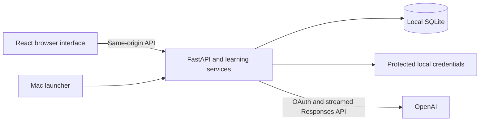

# Daily ML Practice React and Python Design

Approved by the learner in Q20 on 17 November 2026. The approval confirms shared understanding of the first trial, its review rules, and the author-proposed technical defaults.

## Learner-confirmed trial scope

The latest interview narrows the first delivery to self-paced, untimed ML fundamentals practice with introductory deployment and MLOps. Start with approximately 12 reviewed questions organised into topic sections, a complete answer–feedback–review loop, saved answers, working grading, review scheduling, simple history, a practice calendar, and backup. The daily minimum is two distinct questions, with more available whenever the learner has time. Random selection and repeat practice use the reviewed bank, with new content added over time. Richer analytics, reminders, deeper ML engineering, and LLM topics follow later.

The calendar shows zero completed questions as no practice, one as partial, and two or more as goal met, with the actual count visible. Submitted answers count immediately, including pending or disputed grading. A self-reported gap counts after viewing its explanation. Drafts and revisions add no extra count. Unfinished answers remain editable across days, with credit on the day the learner finishes.

The daily pair contains one randomly selected due review when available and one varied question favouring less recently practised sections, from a different section when possible. Without due reviews, both use varied selection. Extra questions continue the mix or use a learner-selected section. Resumed and focused questions also contribute to the daily goal.

In Q19, the learner approved three fundamentals questions on generalisation, leakage and metrics, two forests questions on forest mechanics and tree diversity, two other-ensemble questions on bagging/boosting and boosting trade-offs, two deep-learning questions on backpropagation and overfitting, one deployment question on batch/online inference, and two MLOps questions on reproducible preprocessing and monitoring. Prompt, hint, rubric, explanation and checked-source authoring belong to implementation.

Use brief, general ML examples, reflecting the learner's explicit rejection of WiFi/Bluetooth and workplace-specific crowd analytics scenarios. Provide section browsing and selection, with due reviews available alongside sections. Include a way to flag an assessment as incorrect, retaining the answer, feedback, and objection. Open disputes exclude the challenged assessment from learning progress and review-date calculations. The learner can request a reassessment against the marking guide and references, inspect both explanations, and accept either assessment or leave the dispute open.

The learner confirmed concise-first feedback, expandable teaching detail, an optional follow-up, and one assisted revision per answer. Help viewed before submission is recorded as assisted practice and returns the concept tomorrow. Independently correct attempts on different days progress through 1, 3, 7, 14, and 30-day gaps. Substantial gaps and self-reported gaps return tomorrow. Mostly correct answers with an important omission return in three days under the latest approved recommendation. Both interview rounds were answered, and the learner confirmed the three-day interpretation in Q20.

An open dispute uses other undisputed evidence for scheduling. If none remains, show “Awaiting accepted assessment,” clear the disputed evidence's date, preserve learner-requested earlier reviews, and retain eligibility for varied and focused practice. Resolving the dispute applies the selected assessment to the original answer.

ChatGPT plan controls govern grading availability. Show local request counts and connection status, retain pending answers and calendar credit, and offer explicit later send or retry. The trial's confirmed workflow is reflected in the specification and implementation-plan revision.

## Authority and decisions

The functional requirements come from [daily-ml-practice-spec.md](</Users/calixtan/Documents/ChatGPT/ML Learning/daily-ml-practice-spec.md>), version 1.5. The user selected **“Match MagicPath closely: React interface with a Python backend.”** Apply the trial requirements and AC01–AC23, with AC17 reserved for later reminder work.

Inspected MagicPath reference:

- Project: `473429111537307648`, Daily ML Practice — Today.
- Component: `473429115328958464`, generated name `kind-coast-3041`.
- Pinned revision: `473455629521022976`, selected on the canvas when inspected.
- Canvas frame: 1440 × 1120. The returned preview shows the top of the screen; source inspection supplies the rest of the flow and responsive rules.
- Read the rendered component and its complete React/CSS source. The design has three example questions, browser-local draft persistence, simulated feedback, and sample Progress, History, and Settings views. These are implementation references, not working learning or grading services.

## Intent and scope

Build a personal learning app that runs on this learner's Mac and opens in a browser. Practice is self-paced and untimed, initially using approximately 12 reviewed questions across selected ML and introductory deployment/MLOps sections. The learner writes explanations, receives rubric-based feedback, and revisits concepts.

Success is durable practice history and demonstrated recall over time. A failed model request must preserve the answer. Assisted practice must remain distinguishable from independent recall. The UI must closely reproduce the supplied design while showing truthful data and recoverable states.

The personal trial includes the practice view, simple history, necessary settings, ChatGPT plan sign-in, review scheduling, assessment disputes, and local backup and restore. Full Progress analytics and the optional macOS reminder follow trial use. The existing four-view designs provide an expansion reference.

## Approaches

| Approach | Tradeoff | Outcome |
| --- | --- | --- |
| Streamlit with Python | One language and straightforward forms; close reproduction of the supplied layout and interaction would require substantial workarounds | Superseded by the user's React choice |
| React/TypeScript with a Python HTTP backend | Adds a frontend build toolchain; directly reuses the MagicPath visual source and keeps learning rules in Python | Selected by the user, with FastAPI included in the Q20 design approval |
| Hosted React application and hosted backend | Adds remote operation, accounts, and data administration | Excluded by the local Mac delivery boundary |

## Approved architecture

Use React, TypeScript, Vite, and the existing component's CSS and Lucide icons. Use FastAPI/Pydantic for browser requests, Python's `sqlite3` for learning data, and the official OpenAI Python SDK for streamed grading. Use maintained OAuth/OIDC/JWT libraries for authentication validation. Pin compatible dependencies during implementation using `uv.lock` and npm's lockfile; version numbers are not claimed as tested by this plan.

In the installed application, a single Python process serves both `/api/*` and the compiled React assets on `127.0.0.1`. Browser and API share one origin: the same scheme, host, and port. Node is needed for frontend development/building, not for everyday app use after assets are built. During UI development, use Vite's `/api` proxy, without enabling permissive CORS.

Use three hash-addressed views (`#/today`, `#/history`, `#/settings`), React state, native `fetch`, and short polling while a grading request is active. A hash identifies the browser view without a server route. Add the richer Progress view after trial feedback.

Python is the authority for question selection, dates, submitted text, completion, grades, support flags, review dates, and request records. React owns temporary editing and display state. Browser storage is not the primary learning database. OAuth credentials never pass to React.

Use an app-instance file lock to permit one backend owner per data directory and one server worker. A small in-process grading worker consumes persisted requests. Persisted state supports restart recovery; it does not imply automatic resending of uncertain requests. No external queue, Redis, or separate worker service is necessary.

## Preserve and complete the MagicPath interface

| Surface | Preserve from the reference | Complete for real use |
| --- | --- | --- |
| Navigation and shell | Dark canvas, system font, book mark, left navigation, rounded active item, translucent top bar | Truthful account/connection labels and actual weekly completion; neutral display before sign-in |
| Today | Completion strip, navy question region, metadata, answer editor, save/submit/gap controls | Practice calendar, actual daily count, resumable work, backend-confirmed draft status, pending grading and recovery |
| Session list | Selected question, numbered items, more-question action, review note | Saved review/variety pair, section selection, per-item grading status, actual due dates, further questions on demand |
| Feedback | Assessment area, expandable explanation, references, revision and review-sooner actions | Complete validated feedback fields, grade calculated in Python, clarification, one assisted revision |
| Later Progress | Six-domain emphasis and restrained visual language | Detailed analytics after trial feedback |
| History | Return to saved work | Filters, exact question snapshot, original/clarified/revised text, disputes, grading recovery, cross-day draft resumption |
| Settings | Existing visual language | Timezone, real model catalog, connection, usage counts, and backup controls |

Retain core source tokens: canvas `#000000`, surface `#161618`, ink `#f5f5f7`, muted text `#a3a3ad`, accent `#8eb2ea`, and question background `#192336`. Preserve the visible proportions: 236px desktop sidebar, 232px session column, 24px main-column gap, and up to 1280px main content. Consolidate repeated CSS overrides while preserving computed appearance.

Use the source's 1020px breakpoint for the compact session selector and 680px breakpoint for top navigation. The optional-question action must remain reachable when the session aside is hidden. Validate at 1440, 1024, 768, and 390px, plus 200% zoom. Preserve keyboard focus, a skip link, visible labels, text status, polite live announcements, 44px controls, reduced motion, and reduced transparency. Remove the invalid Google Fonts request for `-apple-system`; use the installed system stack so the interface works offline.

The returned source places hint/reference access in the question area and uses a simulated 850ms feedback delay. Retain the placement and remove the simulation. Disable only conflicting actions for the current item; grading one question must not block navigation to another.

Progress, History, and Settings have sample layouts rather than complete designs. Extend them using the inspected shell and tokens. Exact compositions for those views and keyboard focus details are builder decisions, bounded by the original spec and accessibility requirements.

## Behavior and invariants

1. **Recommendation identity:** save a day's review/variety pair and its question snapshots in one transaction. A unique local date and unique slot make refreshes/two tabs return the same items. Save later selections on demand. Practice items retain their original snapshots when resumed on later days.
2. **Draft ownership:** save explicitly and before in-app navigation. A conditional version check prevents an older tab overwriting a newer draft. On conflict, retain the local text and offer the saved version; never overwrite either silently. Only show “Draft saved” after SQLite acknowledges it. If navigation-save fails, keep the editor and offer retry/copy.
3. **Submission:** validate length and content, determine the current completion date, and atomically save immutable submitted text, calendar credit, and its logical grading request before any provider call. Retry of the same browser action returns that saved result. Original attempts, clarification submission versions, and assisted revisions retain their identities and relationships.
4. **Pending grading:** `awaiting_access`, `awaiting_allowance`, `queued`, `in_flight`, `needs_clarification`, `outcome_unknown`, `failed_recoverable`, and `assessed` are distinct states. An empty/partial provider stream does not count as assessment. Startup preserves interrupted work as outcome unknown; a later send requires an explicit recovery action. A queued-but-unsent request remains recoverable without falsely claiming provider execution.
5. **Calendar completion:** a saved original answer counts immediately, including pending or disputed grading. A self-reported gap counts after its explanation is viewed. Use at most one credit per question per completion local date. Drafts, retries, clarifications, revisions, and reassessments add no duplicate credit. Show zero as no practice, one as partial, and two or more as goal met, with actual counts. Preserve the goal of two when content is unavailable.
6. **Support:** persist hint/reference use before returning that content. Capture pre-submission support on the immutable attempt. Viewing an explanation after submission preserves its saved support status. A self-reported gap can complete locally after the explanation is viewed.
7. **Scheduling:** follow specification section 7. Independent grade 3 uses the current 1/3/7/14/30-day interval and advances once per concept per day. Grade 2 resets progression and returns in three days. Grade 0/1, a viewed self-reported gap, and pre-submission help reset progression and return tomorrow. Replay eligible original learning events in submission order on delayed feedback or dispute changes. Revisions retain their original event relationship. A dispute with no accepted assessment exposes the awaiting-assessment state and retains manual earlier reviews. Provider failures preserve learning evidence and calendar credit.
8. **Grading:** validate every criterion exactly once; compute weighted coverage and the 0–3 grade locally. Respect the 0.25/0.60/0.85 boundaries and critical-misconception cap of 1. Only `response.completed` plus full schema validation may commit feedback and a scheduling event, together.
9. **Usage:** persist each outbound model attempt and show the rolling 24-hour request count, including tests, retries, revisions, reassessments, and clarification. ChatGPT plan controls govern availability. Report exact remaining provider allowance only when supplied by a documented response. Claim each logical grading request atomically so simultaneous tabs reuse its result.
10. **Cross-day practice:** retain editable unfinished answers and support access across midnight. Prepare the new day's saved recommendations and keep resumed work reachable. Credit Monday's unfinished answer to Tuesday when it is submitted Tuesday. Later grading and dispute resolution preserve that completion date. The functional specification records the timezone and calendar-display defaults approved in Q20.
11. **History and data safety:** store immutable question/rubric/source snapshots. Bank imports are all-or-nothing. Backups exclude credentials. Migrations and restore validate and protect existing data before replacement.

Character limits use Unicode code points consistently in Python and React (`len(text)` and `Array.from(text).length`). Reject oversized content without silently truncating answers. The browser's UTF-16-based `maxLength` is insufficient as the shared definition.

## Provider connection and local security

The first implementation milestone must prove browser sign-in, protected credential storage/refresh, the actual account's models, and a completed schema-validated grading request. The official registration, model, and preview pages were read on 17 November 2026. Their public documentation supports the route in the spec, but this planning work did not test this learner's eligibility or spend plan usage.

Use first-time `dynamic_agent_client` registration and retain the issued client ID. Persist a host ID, state, nonce, and PKCE challenge correctly; use the exact documented `http://127.0.0.1:<port>/auth/callback` redirect rules. Validate ID-token signature, issuer, audience, expiry, nonce, verified identity, and granted `chatgpt.tokens.use.direct` scope. Returning sign-in must reject a different client/identity and preserve the existing valid account until replacement credentials validate. The temporary callback listener exits after success, cancellation, or timeout.

Store credentials with directory `0700` and file `0600`, atomic writes, and a cross-process refresh lock. Sign-out clears local tokens, preserves learning records, stops new inference and token refresh, and prevents an already-running refresh from recreating credentials. An already-sent grading result may still be saved; explain this in Settings.

Use the public Responses API with `store=false`, `stream=true`, context in an `input` array, and instructions/developer messages. Omit preview-unsupported fields, including token caps, temperature, metadata, background, conversation, and `previous_response_id`. Use structured output if the selected route supports it; otherwise request JSON and validate the same schema. Record tested model, SDK/auth versions, prompt version, and date. No separately billed API-key fallback is authorized.

Keep the server loopback-only. Validate Host and Origin against its actual bound address; reject cross-origin writes and avoid permissive CORS. Require a same-origin, per-instance CSRF token on mutations with an HttpOnly/SameSite session cookie. This protects writes from another website visited in the browser; it is not multi-user account authentication. Generate the protection anew after restart. OAuth callbacks use their own state/nonce validation. Never execute submitted code or raw model HTML. Sanitize rendered Markdown, allowing only safe external link schemes. Build assets contain no remote font/script dependency.

Tokens, codes, callback queries, authorization headers, raw answer text, and question content stay out of operational logs. Use rotating Python logs with state, redacted failure category, model ID, latency, and supplied usage. Credential files stay outside the learning DB and backups and are excluded from source control.

## Implementation defaults approved in Q20

The author proposed these defaults and the learner approved the complete design on 17 November 2026. Implementation must collect the required evidence for account access, grading and recovery.

- Use SQLite for learning records and editable user preferences. Load packaged defaults, saved SQLite preferences, installation TOML overrides, and environment overrides in that precedence order. Show override provenance in Settings. A backup includes the one authoritative preferences record with the learning data.
- Start in `Europe/London`, recording UTC timestamps plus immutable completion local dates and timezone. Later timezone changes affect later completions. Future dates and dates before first use remain unmarked on the calendar.
- Give each starter question one primary section and concept, with tags for overlapping topics. The starter allocation and topics are learner-confirmed in Q19.
- Use the four-level grading contract and local weighted-coverage boundaries of 0.25, 0.60, and 0.85. A rubric-defined critical misconception caps the result at grade 1. These thresholds are technical defaults for validation and evaluation.
- Use an 8,000-Unicode-code-point answer limit and a 60-second model-request deadline. Keep these values in validated configuration. They describe input capacity and request recovery.
- At a mostly correct result, reset the review progression before scheduling three days ahead. At a same-day repeat, preserve the earlier due date when the result reveals a gap. These deterministic mechanics implement the confirmed outcomes.

## Delivery order and review

1. Working local connection milestone, using the production connection and validation path.
2. MagicPath-based Today page with real durable sessions and drafts.
3. Real saved-answer grading with request recovery and transparent plan usage.
4. Complete learning rules, hints, revisions, and session summaries.
5. Complete the reviewed starter content, simple History, necessary Settings, and backup/restore.
6. Offline and browser verification, real-account grading evaluation, macOS setup, and recovery evidence.

Before application code changes, associate work with a real Jira issue and record the amended scope and acceptance criteria. This directory currently has no Git repository; initialize/version it as an explicit implementation prerequisite after checking the intended repository location. This planning task creates neither a Jira issue nor an application scaffold.

An earlier builder check identified the authorizing Jira issue and intended Git location as implementation preconditions. The plan proposes this workspace as the local repository root. Its preflight discovers the actual Jira issue and checks whether an existing repository should be reused before application edits. The fresh consolidated-design review identified starter-content ownership and allocation as its remaining product question. The learner resolved it in Q19 by approving the allocation and delegating detailed content authoring/review to implementation. In Q20 on 17 November 2026, the learner confirmed that the complete design captures their intended first trial, completing the shared-understanding review.

Accept only verified functionality. Preview eligibility, structured output support, actual token refresh, real grading quality, and clean-Mac startup remain live checks. Record any pending required check and keep its implementation issue open under the workspace lifecycle rules.

## Official references checked

- [Registration and sign-in](https://developers.openai.com/siwc/token-sharing-open-source/sign-in)
- [Models and inference](https://developers.openai.com/siwc/token-sharing-open-source/models-and-inference)
- [Preview limitations](https://developers.openai.com/siwc/token-sharing-open-source/preview-limitations)

The original specification also links account/session renewal and recovery guidance. Recheck those documents during authentication implementation, especially preview changes.
